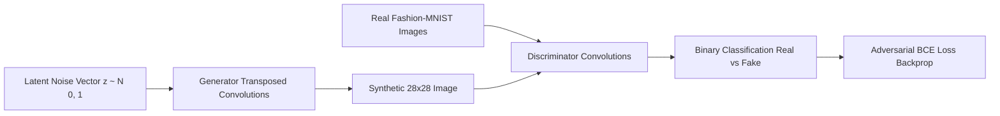

# DCGAN Fashion Studio: Generative Adversarial Network for Fashion Synthesis

A Deep Convolutional Generative Adversarial Network (DCGAN) implemented in PyTorch with an interactive Streamlit web dashboard to train, visualize, and generate 28x28 grayscale fashion apparel images.

## 📌 Problem Statement
Synthesizing realistic apparel imagery is a foundational challenge in generative computer vision. This project implements adversarial deep learning to train two competing neural networks—a Generator and a Discriminator—to learn clothing distributions from the Fashion-MNIST dataset.

## 🚀 Key Features
- **Dual Architecture:** PyTorch-based Generator (`ConvTranspose2d`, `BatchNorm2d`, `ReLU`, `Tanh`) and Discriminator (`Conv2d`, `LeakyReLU`, `Dropout`, `Sigmoid`).
- **Interactive Streamlit Studio:** Dynamic control over epochs, batch sizes, learning rate, and latent space dimension ($z = 100$).
- **Synthetic Data Fallback:** Built-in procedural image generator for rapid testing without internet/dataset downloads.
- **Live Loss Monitoring:** Real-time logging of Generator and Discriminator losses with downloadable CSV history.
- **Checkpoint Persistence:** Save and reload model weights without losing training progress.
- **Automated Testing:** Pytest unit test suite verifying tensor output dimensions and adversarial losses.

## 🏗️ Architecture & Workflow


## 📂 Repository Structure
```
DCGAN-Fashion-Website/
├── app.py                 # Interactive Streamlit Web Application
├── dcgan.py               # Generator & Discriminator PyTorch Neural Models
├── train.py               # Adversarial training loop & checkpoint manager
├── dataset.py             # Fashion-MNIST dataloader & normalization
├── generate_synthetic.py  # Procedural synthetic image generator
├── test_dcgan.py          # Pytest test suite for model verification
├── requirements.txt       # Project dependencies
└── checkpoints/           # Serialized model weights
```

## ⚙️ Installation & Setup
1. **Clone the repository:**
   ```bash
   git clone https://github.com/Bhumikaravi/DCGAN-Fashion-Website.git
   cd DCGAN-Fashion-Website
   ```
2. **Create and activate a virtual environment:**
   ```bash
   python -m venv .venv
   # Windows:
   .venv\Scripts\activate
   # Linux/macOS:
   source .venv/bin/activate
   ```
3. **Install dependencies:**
   ```bash
   pip install -r DCGAN-Fashion-Website/requirements.txt
   ```
4. **Run the Streamlit application:**
   ```bash
   cd DCGAN-Fashion-Website
   streamlit run app.py
   ```
5. **Run test suite:**
   ```bash
   pytest -v
   ```

## 👩‍💻 Contribution & Verified Results
- Developed by **Bhumika Ravi** as part of Generative AI & Deep Learning exploration.
- Implemented the adversarial training loop, tensor dimension alignment, Streamlit web UI, and weight persistence logic.
