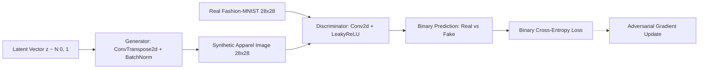

<p align="center">
  
</p>

<p align="center">
       
</p>


## 📌 Table of Contents
- [📖 Executive Summary](#-executive-summary)
- [✨ Key Features & Capabilities](#-key-features--capabilities)
- [🏗️ System Architecture & Workflow](#️-system-architecture--workflow)
- [🛠️ Tech Stack Breakdown](#️-tech-stack-breakdown)
- [⚙️ Reproducible Quickstart & Setup](#️-reproducible-quickstart--setup)
- [📂 Project Directory Layout](#-project-directory-layout)
- [👩‍💻 Author & Contributions](#-author--contributions)

---

## 📖 Executive Summary
### Problem Statement
High-resolution synthetic apparel generation requires balanced adversarial deep learning. Traditional generative models often suffer from mode collapse, unstable gradients, or prohibitive training requirements on consumer hardware.

### Motivation & Solution Overview
DCGAN Fashion Studio provides an end-to-end Deep Convolutional Generative Adversarial Network implementation in PyTorch coupled with an interactive Streamlit dashboard. It enables real-time hyperparameter tuning, loss inspection, synthetic sample generation, and model checkpoint persistence.

---

## ✨ Key Features & Capabilities
- **Deep Convolutional Architecture:**
  - **Generator:** Uses transposed 2D convolutions (`ConvTranspose2d`), `BatchNorm2d`, and `ReLU` activations, mapping 100D latent noise $z$ to 28x28 grayscale images via `Tanh`.
  - **Discriminator:** Uses strided 2D convolutions (`Conv2d`), `LeakyReLU(0.2)`, and dropout regularizations with binary cross-entropy output.
- **Interactive Streamlit Studio:** Dynamic sliders for learning rate, batch size, epoch control, and latent space sampling.
- **Built-in Procedural Synthetic Data:** Instant offline training fallback generating synthetic clothing silhouettes without downloading full datasets.
- **Automated Verification:** Comprehensive Pytest test suite testing tensor dimensional consistency and loss sanity across GPU/CPU.

---

## 🏗️ System Architecture & Workflow


---

## 🛠️ Tech Stack Breakdown
| Component | Technologies |
|---|---|
| **Deep Learning Framework** | PyTorch, Torchvision |
| **Model Architecture** | Deep Convolutional Generative Adversarial Network (DCGAN) |
| **Web Interface** | Streamlit, Matplotlib |
| **Testing & CI** | Pytest, GitHub Actions CI Workflow |
| **Dataset** | Zalando Fashion-MNIST (10 apparel classes) |

---

## ⚙️ Reproducible Quickstart & Setup
### Prerequisites
- Python 3.10 or 3.11
- PyTorch

### Quickstart
```bash
# 1. Clone repository
git clone https://github.com/Bhumikaravi/DCGAN-Fashion-Website.git
cd DCGAN-Fashion-Website

# 2. Virtual environment setup
python -m venv .venv
# On Windows:
.venv\Scripts\activate
# On Linux/macOS:
source .venv/bin/activate

# 3. Install requirements
pip install -r DCGAN-Fashion-Website/requirements.txt

# 4. Launch Streamlit Studio
cd DCGAN-Fashion-Website
streamlit run app.py

# 5. Run automated tests
pytest test_dcgan.py -v
```

---

## 📂 Project Directory Layout
```text
DCGAN-Fashion-Website/
├── .github/workflows/ci.yml # Automated Pytest CI Pipeline
├── LICENSE                  # MIT License
├── README.md                # Project Documentation
└── DCGAN-Fashion-Website/
    ├── app.py               # Streamlit Interactive Web Application
    ├── dcgan.py             # Generator & Discriminator PyTorch Neural Models
    ├── train.py             # Adversarial training loop & checkpoint manager
    ├── dataset.py           # Fashion-MNIST dataloader & normalization
    ├── generate_synthetic.py# Procedural synthetic image generator
    ├── test_dcgan.py        # Pytest test suite for model verification
    ├── requirements.txt     # Dependencies
    └── checkpoints/         # Serialized model weights
```

---

## 👩‍💻 Author & Contributions
Developed by **Bhumika Ravi** ([@Bhumikaravi](https://github.com/Bhumikaravi)), Bachelor of Computer Applications (BCA) at **Alliance University, Bengaluru**.

- 💻 **GitHub Profile:** [github.com/Bhumikaravi](https://github.com/Bhumikaravi)
- 🔗 **LinkedIn:** [linkedin.com/in/bhumika-ravi-b5a01b326](https://www.linkedin.com/in/bhumika-ravi-b5a01b326/)
- 📬 **Email Contact:** [bhumikaravi2006@gmail.com](mailto:bhumikaravi2006@gmail.com)

---

<p align="center">
  
</p>
